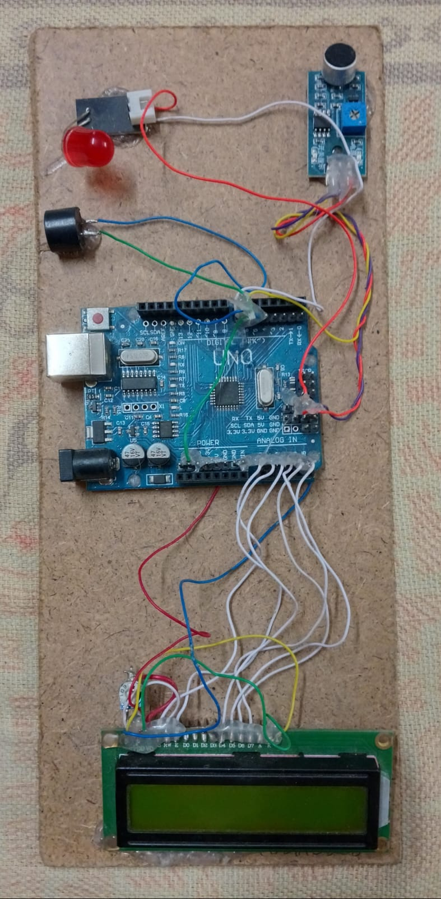

# Smart Noise Monitor System

An IoT-based Smart Noise Monitoring System designed to detect excessive noise levels, provide real-time alerts, and support remote noise monitoring.

## Project Overview

The Smart Noise Monitor System is designed to monitor environmental noise using a sound sensor and a microcontroller.

When noise exceeds a predefined threshold, the system provides visual and audio alerts using LEDs and a buzzer. An LCD displays the monitoring status.

The upgraded version introduces ESP32 Wi-Fi connectivity and ThingSpeak cloud integration for remote monitoring.

## Features

- Real-time sound signal monitoring
- Adjustable noise threshold using a potentiometer
- Three-second warning mechanism
- Red LED indication for excessive noise
- Green LED indication for normal conditions
- Buzzer-based alert system
- 16x2 LCD status display
- ESP32 Wi-Fi connectivity
- ThingSpeak cloud data monitoring

## Technologies Used

- Arduino UNO
- ESP32
- Embedded C/C++
- Arduino IDE
- Sound Sensor
- 16x2 LCD
- LEDs and Buzzer
- ThingSpeak IoT Cloud
- Wi-Fi Communication

## System Architecture

Sound Sensor → ESP32 → Noise Analysis → Alert System → LCD Display

ESP32 → Wi-Fi → ThingSpeak Cloud → Remote Monitoring

## Project Versions

### Version 1: Arduino UNO
- Sound detection
- Adjustable threshold
- LCD display
- LED and buzzer alerts

### Version 2: ESP32 IoT Upgrade
- Wi-Fi connectivity
- Cloud data transmission
- Remote monitoring
- Improved noise analysis

## Applications

- Smart cities
- Educational institutions
- Hospitals
- Industrial environments
- Residential areas
- Public noise monitoring

## Future Enhancements

- Calibrated decibel measurement
- Mobile application integration
- Real-time push notifications
- Historical noise analysis
- GPS-based noise monitoring
- Multiple sensor integration

---

## Hardware Prototype

The image below shows the physical prototype of the Smart Noise Monitor System developed using Arduino UNO and electronic components.

## Working Principle

1. The sound sensor detects environmental noise.
2. The sensor sends an analog signal to the Arduino UNO.
3. The Arduino processes the signal and compares it with the adjustable threshold.
4. When excessive noise is detected, the red LED provides a visual warning.
5. If the noise continues beyond the warning period, the buzzer is activated.
6. The 16x2 LCD displays the current monitoring status.

